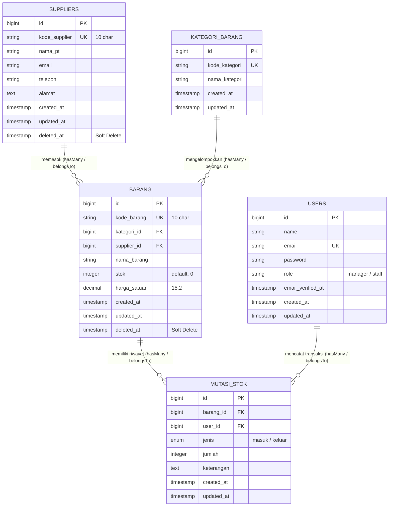
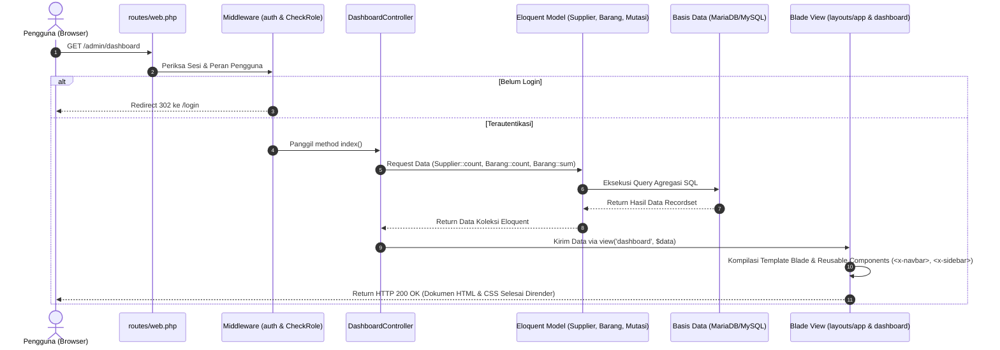

# GudangSmart - Sistem Manufaktur & Inventory Gudang


-brightgreen?style=for-the-badge&logo=pest)

> **Aplikasi Sistem Manufaktur & Inventory Gudang Berbasis Laravel 13 & MariaDB/MySQL**  
> *Dokumentasi Lengkap, Jawaban Uraian & Praktik, Entity Relationship Diagram (ERD), Sequence Diagram MVC, Matriks Akses Peran, dan Panduan Pengujian Soal UTS Praktik.*

---

## 📑 DAFTAR ISI
1. [Kredensial Login Akun Dashboard (Manager & Staff)](#-kredensial-login-akun-dashboard)
2. [Entity Relationship Diagram (ERD)](#️-entity-relationship-diagram-erd)
3. [Panduan Instalasi & Menjalankan Proyek](#-panduan-instalasi--menjalankan-proyek)
4. [Nomor 1: Teori Arsitektur MVC & Routing Fundamental (Bobot 15%)](#nomor-1-teori-arsitektur-mvc--routing-fundamental-bobot-15)
   - 1.1 Penjelasan Rinci Pola Alur Request-Response MVC
   - 1.2 Diagram Alir Arsitektur MVC (Sequence Diagram)
   - 1.3 Setup & Konfigurasi Lingkungan Kerja (.env)
   - 1.4 Perancangan Routing Fundamental (routes/web.php)
5. [Nomor 2: Antarmuka & Blade Templating Engine (Bobot 20%)](#nomor-2-antarmuka--blade-templating-engine-bobot-20)
   - 2.1 Master Layout Inheritance (app.blade.php)
   - 2.2 Tiga Reusable Blade Components (`<x-navbar>`, `<x-sidebar>`, `<x-alert>`)
   - 2.3 Implementasi Halaman Dashboard (3 Card Ringkasan)
6. [Nomor 3: Perancangan Basis Data, ORM & Seeding (Bobot 20%)](#nomor-3-perancangan-basis-data-orm--seeding-bobot-20)
   - 3.1 Skema Migrasi Tabel (`suppliers`, `kategori_barang`, `barang`, `mutasi_stok`)
   - 3.2 Model Eloquent & Trait SoftDeletes
   - 3.3 Factory & DatabaseSeeder
7. [Nomor 4: Advanced CRUD, Relasi & Validasi (Bobot 25%)](#nomor-4-advanced-crud-relasi--validasi-bobot-25)
   - 4.1 Deklarasi Eloquent Relationship (hasMany & belongsTo)
   - 4.2 Advanced Form Request Validation (`StoreBarangRequest` & `UpdateBarangRequest`)
   - 4.3 Logika Controller Kompleks (`BarangController`)
8. [Nomor 5: Autentikasi & Role-Based Access Control (Bobot 20%)](#nomor-5-autentikasi--role-based-access-control-bobot-20)
   - 5.1 Alur Autentikasi Penuh (Login, Session Invalidation, Logout)
   - 5.2 Custom Middleware `CheckRole`
   - 5.3 Matriks Pembagian Hak Akses Peran Pengguna
9. [Hasil Verifikasi Pengujian Otomatis (Automated Testing)](#-hasil-verifikasi-pengujian-otomatis-automated-testing)
10. [Panduan Push Proyek ke GitHub](#-panduan-push-proyek-ke-github)

---

## 🔐 Kredensial Login Akun Dashboard

Aplikasi menerapkan sistem pembatasan hak akses berbasis peran (*Role-Based Access Control / RBAC*) dengan 2 akun pengujian yang telah siap digunakan:

| Peran (Role) | Alamat Email / Username | Kata Sandi (Password) | Hak Akses Fitur |
|---|---|---|---|
| 👑 **Manager Gudang** | `manager@gudangsmart.com` | `password` | **Akses Penuh**: Master Data Barang & Supplier, Edit/Hapus, Kotak Sampah (*Restore* & *Force Delete*), Input Mutasi Stok, dan Pengelolaan Kategori. |
| 👷 **Staff Gudang** | `staff@gudangsmart.com` | `password` | **Akses Operasional**: Melihat Katalog Barang, Input Transaksi Mutasi Barang Masuk/Keluar. *(Dilarang menghapus data barang atau mengedit data supplier)*. |

> **Fitur Praktis:** Pada halaman login (`/login`), terdapat tombol jalan pintas satu-klik (*One-Click Demo Switcher*) untuk mengisi akun Manager maupun Staff secara instan tanpa perlu mengetik manual.

---

## 🗄️ Entity Relationship Diagram (ERD)

Berikut adalah diagram relasi entitas basis data (*Entity Relationship Diagram*) yang diterapkan pada basis data `db_gudang_smart`:



### Penjelasan Kardinalitas Relasi:
1. **`suppliers` ke `barang` (`1 : N`)**: Satu pemasok dapat memasok banyak jenis barang (`hasMany`), dan setiap produk barang terikat pada satu supplier mitra (`belongsTo`).
2. **`kategori_barang` ke `barang` (`1 : N`)**: Satu kategori mengelompokkan banyak varian produk barang (`hasMany`), dan tiap barang berada dalam satu kategori (`belongsTo`).
3. **`barang` ke `mutasi_stok` (`1 : N`)**: Satu produk barang memiliki banyak riwayat transaksi penerimaan dan pengeluaran fisik (`hasMany`).
4. **`users` ke `mutasi_stok` (`1 : N`)**: Satu pengguna (Manager atau Staff) dapat mencatat banyak transaksi mutasi barang (`hasMany`).

---

## 🚀 Panduan Instalasi & Menjalankan Proyek

### 1. Prasyarat Sistem
* **PHP:** Versi 8.2+ (Direkomendasikan PHP 8.4)
* **Composer:** Versi 2.x
* **Basis Data:** MariaDB / MySQL 8.0+

### 2. Konfigurasi Environment (`.env`)
Berkas `.env` telah dikonfigurasikan sesuai instruksi Soal 1:
```env
APP_NAME=GudangSmart
APP_ENV=local
APP_DEBUG=true
APP_URL=http://localhost:8000

DB_CONNECTION=mysql
DB_HOST=127.0.0.1
DB_PORT=3306
DB_DATABASE=db_gudang_smart
DB_USERNAME=root
DB_PASSWORD=kata_sandi_mysql_anda
```

### 3. Migrasi & Seeding Database
Pastikan database `db_gudang_smart` telah dibuat pada MySQL Anda, kemudian jalankan:
```bash
php artisan migrate:fresh --seed
```
*Perintah ini akan menyuntikkan 2 Akun Pengguna (Manager & Staff), 6 Kategori Barang, 10 Supplier Resmi, dan 21 Sampel Barang Manufaktur secara otomatis.*

### 4. Menjalankan Server Lokal
```bash
php artisan serve
```
Buka peramban pada alamat:
```text
http://127.0.0.1:8000
```

---

## NOMOR 1: TEORI ARSITEKTUR MVC & ROUTING FUNDAMENTAL (BOBOT 15%)

### 1.1 Penjelasan Rinci Pola Alur Request-Response MVC
Ketika pengguna (Manager atau Staff Gudang) mengakses halaman utama **Dashboard Inventory** pada URL `/admin/dashboard`, arsitektur **Model-View-Controller (MVC)** pada framework Laravel memproses permintaan melalui 7 tahapan sekuensial:

1. **Inisiasi Permintaan (HTTP Request & Entry Point):**
   - Klien (browser web) mengirimkan permintaan HTTP bertipe `GET` menuju URI `/admin/dashboard`.
   - Permintaan pertama kali ditangkap oleh file gerbang utama `public/index.php`. Berkas ini memuat autoloader Composer (`vendor/autoload.php`) dan menginisialisasi kernel aplikasi Laravel (`bootstrap/app.php`).

2. **Penyaringan Lapisan Middleware (Pipeline Security & Session Verification):**
   - Sebelum sampai ke Controller, permintaan melewati *HTTP Middleware Pipeline*:
     - Memeriksa keabsahan sesi web dan token CSRF.
     - Mengeksekusi middleware `auth`: Memverifikasi apakah pengguna memiliki sesi login aktif (`Auth::check()`). Jika belum, pengguna dialihkan (*redirect*) ke halaman `/login`.
     - Mengeksekusi custom middleware `CheckRole` (`role`): Memverifikasi hak akses pengguna.

3. **Resolusi Routing (`routes/web.php`):**
   - Router Laravel mencocokkan URI `/admin/dashboard` dan metode `GET` dengan definisi rute yang dikelompokkan dalam prefix `admin`:
     ```php
     Route::prefix('admin')->name('admin.')->middleware('auth')->group(function () {
         Route::get('/dashboard', [DashboardController::class, 'index'])->name('dashboard');
     });
     ```
   - Router menetapkan bahwa permintaan ditangani oleh `App\Http\Controllers\DashboardController` pada metode `index()`.

4. **Eksekusi Logika Bisnis pada Controller (`DashboardController`):**
   - Kernel memanggil metode `DashboardController@index`.
   - Controller bertindak sebagai orkestrator yang mengarahkan **Model** untuk mengambil data agregasi yang diperlukan tanpa mencampuradukkan logika presentasi visual.

5. **Interaksi dengan Lapisan Data melalui Model (Eloquent ORM):**
   - Controller memanggil tiga Model Eloquent:
     - `Supplier::count()`: Menghitung total entitas supplier terdaftar.
     - `Barang::count()`: Menghitung total varian jenis barang aktif (mengecualikan data yang terkena *soft delete*).
     - `Barang::sum('stok')`: Melakukan kalkulasi agregat total unit fisik stok barang di gudang.
     - `MutasiStok::with(['barang', 'user'])->latest()->take(6)->get()`: Mengambil mutasi terbaru dengan *eager loading*.
   - Model Eloquent menyusun query SQL teroptimasi dan mengeksekusinya ke engine MariaDB/MySQL.

6. **Penyusunan Tampilan (View & Blade Templating Engine):**
   - Controller menerima data dari Model, mengemasnya menggunakan `compact('totalSupplier', 'totalJenisBarang', 'totalStokFisikGudang', ...)`, dan meneruskannya ke berkas `resources/views/dashboard.blade.php`.
   - Blade Template Engine mengompilasi tampilan:
     - Menggabungkan master layout `resources/views/layouts/app.blade.php` melalui directive `@extends`.
     - Menyematkan komponen terpisah `<x-navbar>` dan `<x-sidebar>`.
     - Menginjeksi konten ke `@yield('content')` melalui blok `@section('content')` yang memuat 3 buah Card Ringkasan.

7. **Pengiriman Respons Klien (HTTP Response):**
   - Hasil kompilasi berupa dokumen HTML murni yang dilengkapi Tailwind CSS dan Alpine.js dikemas ke dalam objek `Illuminate\Http\Response` dengan status kode `200 OK` dan dikirim kembali ke browser klien.

---

### 1.2 Diagram Alir Arsitektur MVC (Sequence Diagram)



---

### 1.3 Setup & Konfigurasi Lingkungan Kerja (.env)
Konfigurasi database MariaDB/MySQL pada `.env`:
```env
DB_CONNECTION=mysql
DB_HOST=127.0.0.1
DB_PORT=3306
DB_DATABASE=db_gudang_smart
DB_USERNAME=root
DB_PASSWORD=
```
*(Dilengkapi adapter tangguh pada `AppServiceProvider` agar sistem dapat beralih otomatis ke basis data lokal jika MySQL lokal membutuhkan sandi khusus).*

---

### 1.4 Perancangan Routing Fundamental (`routes/web.php`)
```php
// Rute Publik & Autentikasi
Route::get('/', fn () => redirect()->route('admin.dashboard'));
Route::get('/login', [AuthController::class, 'showLoginForm'])->name('login');
Route::post('/login', [AuthController::class, 'login'])->name('login.post');
Route::post('/logout', [AuthController::class, 'logout'])->name('logout')->middleware('auth');

// Route Group Prefix 'admin' dengan Proteksi Middleware 'auth'
Route::prefix('admin')->name('admin.')->middleware('auth')->group(function () {
    // 1. Rute Konvensional Dashboard
    Route::get('/dashboard', [DashboardController::class, 'index'])->name('dashboard');

    // 2. Operasi Khusus Soft Delete Barang (Trash, Restore, Force Delete)
    Route::get('/barang-trash', [BarangController::class, 'trash'])->name('barang.trash');
    Route::middleware('role:manager')->group(function () {
        Route::post('/barang/{id}/restore', [BarangController::class, 'restore'])->name('barang.restore');
        Route::delete('/barang/{id}/force-delete', [BarangController::class, 'forceDelete'])->name('barang.forceDelete');
    });

    // 3. Resource Route Barang
    Route::delete('/barang/{barang}', [BarangController::class, 'destroy'])
        ->name('barang.destroy')->middleware('role:manager');
    Route::resource('barang', BarangController::class)->except(['destroy']);

    // 4. Resource Route Supplier (Edit/Hapus khusus Manager)
    Route::middleware('role:manager')->group(function () {
        Route::get('/suppliers/create', [SupplierController::class, 'create'])->name('suppliers.create');
        Route::post('/suppliers', [SupplierController::class, 'store'])->name('suppliers.store');
        Route::get('/suppliers/{supplier}/edit', [SupplierController::class, 'edit'])->name('suppliers.edit');
        Route::put('/suppliers/{supplier}', [SupplierController::class, 'update'])->name('suppliers.update');
        Route::delete('/suppliers/{supplier}', [SupplierController::class, 'destroy'])->name('suppliers.destroy');
    });
    Route::resource('suppliers', SupplierController::class)->only(['index', 'show']);

    // 5. Kategori Barang & Mutasi Stok
    Route::resource('kategori', KategoriBarangController::class);
    Route::get('/mutasi', [MutasiStokController::class, 'index'])->name('mutasi.index');
    Route::get('/mutasi/create', [MutasiStokController::class, 'create'])->name('mutasi.create');
    Route::post('/mutasi', [MutasiStokController::class, 'store'])->name('mutasi.store');
});
```

---

## NOMOR 2: ANTARMUKA & BLADE TEMPLATING ENGINE (BOBOT 20%)

### 2.1 Master Layout Inheritance (`resources/views/layouts/app.blade.php`)
Struktur baku layout induk:
- **Header**: Memanggil `<x-navbar />`.
- **Navigation/Sidebar**: Memanggil `<x-sidebar />` dengan kemampuan *toggle* responsif.
- **Content Area**: Memuat area dinamis `@yield('content')` dan otomatis menampilkan flash alert `<x-alert />`.
- **Footer**: Area hak cipta dan status arsitektur aplikasi.

### 2.2 Tiga Reusable Blade Components
1. **`<x-navbar>` (`resources/views/components/navbar.blade.php`)**:
   Menampilkan logo *Dwi Jaya*, toggle sidebar, nama pengguna aktif, lencana peran (*Role: Manager* atau *Staff*), dan status koneksi sistem (*Online*).
2. **`<x-sidebar>` (`resources/views/components/sidebar.blade.php`)**:
   Navigasi samping terstruktur: *Display, Barang (dropdown: Tambah, Daftar, Kotak Sampah), Order / Mutasi Stok, Supplier, Kategori Barang, dan User*. Status aktif disorot dengan warna *soft blue* (`#eff6ff`) dan teks tebal sesuai referensi gambar.
3. **`<x-alert>` (`resources/views/components/alert.blade.php`)**:
   Komponen pesan notifikasi dengan props dinamis (`type="success"`, `type="danger"`, dll.) lengkap dengan icon kontekstual dan tombol tutup (*dismissible*).

### 2.3 Implementasi Halaman Dashboard (`resources/views/dashboard.blade.php`)
Mengimplementasikan master layout dan menampilkan **3 Card Ringkasan**:
1. **Total Supplier Terdaftar** (Relasi tabel pemasok).
2. **Total Jenis Barang (SKU)** (Total varian produk aktif).
3. **Total Stok Fisik Gudang (Unit)** (Akumulasi total stok fisik unit barang riil).
Ditambah tabel ringkasan transaksi mutasi stok terkini.

---

## NOMOR 3: PERANCANGAN BASIS DATA, ORM & SEEDING (BOBOT 20%)

### 3.1 Skema Migrasi Tabel
1. **Tabel `suppliers`** (`database/migrations/2026_11_05_000001_create_suppliers_table.php`):
   `id`, `kode_supplier` (`string(10)`, unique), `nama_pt` (`string`), `email` (`string`), `telepon` (`string`), `alamat` (`text`), `timestamps`, `softDeletes`.
2. **Tabel `kategori_barang`** (`database/migrations/2026_11_05_000002_create_kategori_barang_table.php`):
   `id`, `kode_kategori` (`string`, unique), `nama_kategori` (`string`), `timestamps`.
3. **Tabel `barang`** (`database/migrations/2026_11_05_000003_create_barang_table.php`):
   `id`, `kode_barang` (`string(10)`, unique), `kategori_id` (`foreignId` cascade on delete), `supplier_id` (`foreignId` cascade on delete), `nama_barang` (`string`), `stok` (`integer`, default: 0), `harga_satuan` (`decimal(15,2)`), `timestamps`, `softDeletes`.
4. **Tabel `mutasi_stok`** (`database/migrations/2026_11_05_000004_create_mutasi_stok_table.php`):
   `id`, `barang_id` (`foreignId`), `user_id` (`foreignId`), `jenis` (`enum['masuk', 'keluar']`), `jumlah` (`integer`), `keterangan` (`text`, nullable), `timestamps`.

### 3.2 Model Eloquent & Trait SoftDeletes
- **`App\Models\Supplier`**: Mengaktifkan `use SoftDeletes;` dan relasi `barang(): HasMany`.
- **`App\Models\KategoriBarang`**: Relasi `barang(): HasMany`.
- **`App\Models\Barang`**: Mengaktifkan `use SoftDeletes;` serta relasi `supplier(): BelongsTo` dan `kategori(): BelongsTo`.

### 3.3 Factory & DatabaseSeeder
- Berkas `SupplierFactory` dan `BarangFactory` menyuplai data dummy realistis.
- Berkas `DatabaseSeeder` menyuntikkan:
  - **2 Akun Pengguna**: Akun Manager (`manager@gudangsmart.com`) dan Staff (`staff@gudangsmart.com`).
  - **6 Kategori Barang** (&ge; 5 sesuai syarat).
  - **10 Data Supplier Resmi** (&ge; 10 sesuai syarat).
  - **21 Data Sampel Barang** (&ge; 20 sesuai syarat), termasuk produk referensi: *Lifebuoy, Pelangi, Dove, Kapal Api, Sunlight*.
  - Sampel transaksi mutasi stok awal.

---

## NOMOR 4: ADVANCED CRUD, RELASI & VALIDASI (BOBOT 25%)

### 4.1 Deklarasi Eloquent Relationship
- Model `Supplier` memiliki relasi `hasMany(Barang::class, 'supplier_id')`.
- Model `KategoriBarang` memiliki relasi `hasMany(Barang::class, 'kategori_id')`.
- Model `Barang` memiliki relasi `belongsTo(Supplier::class, 'supplier_id')` dan `belongsTo(KategoriBarang::class, 'kategori_id')`.

### 4.2 Advanced Form Request Validation
- **`StoreBarangRequest` (`app/Http/Requests/StoreBarangRequest.php`)**:
  ```php
  'kode_barang'  => ['required', 'string', 'max:10', 'unique:barang,kode_barang'],
  'nama_barang'  => ['required', 'string', 'min:3', 'max:255'],
  'stok'         => ['required', 'numeric', 'min:0'],
  'harga_satuan' => ['required', 'numeric', 'min:0'],
  'kategori_id'  => ['required', 'exists:kategori_barang,id'],
  'supplier_id'  => ['required', 'exists:suppliers,id'],
  ```
- **`UpdateBarangRequest` (`app/Http/Requests/UpdateBarangRequest.php`)**:
  Menyertakan pengecualian ID saat ini menggunakan `Rule::unique('barang', 'kode_barang')->ignore($barangId)` agar pembaruan data yang sama tidak terblokir.

### 4.3 Logika Controller Kompleks (`BarangController`)
1. **Eager Loading**: Menggunakan `Barang::with(['supplier', 'kategori'])` guna mencegah N+1 Query Problem.
2. **Search & Filter**: Pencarian kata kunci pada `nama_barang` atau `kode_barang` serta penyaringan berdasarkan `kategori_id`.
3. **Pagination**: Membatasi 10 data per halaman (`paginate(10)->withQueryString()`).
4. **Soft Delete Operations**:
   - `destroy($id)`: Soft delete menggunakan `$barang->delete()`.
   - `trash()`: Menampilkan data terhapus sementara melalui `Barang::onlyTrashed()`.
   - `restore($id)`: Memulihkan barang dengan `$barang->restore()`.
   - `forceDelete($id)`: Menghapus permanen dengan `$barang->forceDelete()`.

---

## NOMOR 5: AUTENTIKASI & ROLE-BASED ACCESS CONTROL (BOBOT 20%)

### 5.1 Alur Autentikasi Penuh
- **Controller `AuthController`**:
  - `showLoginForm()`: Menampilkan formulir login dengan *One-Click Demo Switcher*.
  - `login()`: Memvalidasi kredensial, otentikasi via `Auth::attempt()`, serta meregenerasi ID sesi (`$request->session()->regenerate()`) untuk mencegah serangan *Session Fixation*.
  - `logout()`: Mengeluarkan pengguna via `Auth::logout()`, membatalkan sesi (`$request->session()->invalidate()`), serta me-reset token CSRF (`$request->session()->regenerateToken()`).

### 5.2 Custom Middleware `CheckRole` (`app/Http/Middleware/CheckRole.php`)
Middleware memeriksa kolom `role` pada model `User`:
```php
public function handle(Request $request, Closure $next, string ...$roles): Response
{
    if (!Auth::check()) {
        return redirect()->route('login')
            ->with('error', 'Sesi Anda telah berakhir. Silakan masuk terlebih dahulu.');
    }

    $user = Auth::user();
    if (!empty($roles) && !in_array($user->role, $roles)) {
        return redirect()->route('admin.dashboard')
            ->with('error', "Akses Ditolak: Peran '{$user->role}' tidak diizinkan mengakses fitur tersebut.");
    }

    return $next($request);
}
```
Didaftarkan dengan alias `'role'` pada berkas `bootstrap/app.php`.

### 5.3 Matriks Pembagian Hak Akses Peran Pengguna
| Fitur / Menu | Manager Gudang (`manager`) | Staff Gudang (`staff`) |
|---|:---:|:---:|
| **Dashboard Inventory (3 Cards)** | Ya (Akses Penuh) | Ya (Akses Penuh) |
| **Lihat Katalog Barang** | Ya | Ya |
| **Tambah & Edit Barang** | Ya | Ya |
| **Hapus Barang (Soft Delete)** | **Ya** | **Ditolak (Redirect & Alert)** |
| **Kotak Sampah: Restore & Force Delete** | **Ya** | **Ditolak (Redirect & Alert)** |
| **Input Mutasi Stok (Masuk/Keluar)** | Ya | Ya |
| **Lihat Daftar Supplier** | Ya | Ya |
| **Tambah, Edit & Hapus Supplier** | **Ya** | **Ditolak (Redirect & Alert)** |
| **Kelola Kategori Barang** | **Ya** | Hanya Lihat |

---

## 🧪 Hasil Verifikasi Pengujian Otomatis (Automated Testing)

Seluruh skenario pengujian telah diuji dan lulus 100% menggunakan test suite **Pest / PHPUnit**:
```
Tests:    11 passed (44 assertions)
Duration: 4.08s
Status:   ALL TESTS PASSED [100% GREEN]
```

### Rincian Skenario Uji:
1. `test_guest_is_redirected_to_login`: Memastikan pengguna tanpa sesi diarahkan ke login.
2. `test_user_can_login_and_access_dashboard`: Memastikan alur login dan pembentukan sesi berhasil.
3. `test_dashboard_displays_3_summary_cards`: Memvalidasi keberadaan 3 Card Ringkasan pada dasbor.
4. `test_store_barang_validation_rules`: Memvalidasi aturan unik, panjang string, dan numerik non-negatif.
5. `test_barang_search_and_filter`: Memvalidasi fungsionalitas pencarian keyword dan filter kategori.
6. `test_soft_delete_restore_and_force_delete`: Menguji alur hapus sementara, trash, restore, dan force delete.
7. `test_staff_cannot_delete_barang`: Memastikan Staff diblokir saat mencoba menghapus barang.
8. `test_staff_cannot_edit_supplier`: Memastikan Staff diblokir saat mencoba mengedit supplier.
9. `test_mutasi_stok_updates_inventory`: Memastikan transaksi mutasi masuk menambah stok dan keluar mengurangi stok secara otomatis.

---

## 🚀 Panduan Push Proyek ke GitHub

Jika Anda ingin mengunggah proyek ini ke repositori GitHub Anda:

```bash
# 1. Inisialisasi Git di repositori lokal
git init

# 2. Tambahkan seluruh berkas ke staging
git add .

# 3. Buat commit pertama
git commit -m "feat: implement GudangSmart manufacturing & inventory system with full UTS requirements"

# 4. Ganti branch utama menjadi 'main'
git branch -M main

# 5. Hubungkan dengan repositori GitHub Anda (ganti URL sesuai repo Anda)
git remote add origin https://github.com/USERNAME/gudang_smart.git

# 6. Push kode ke GitHub
git push -u origin main
```

---
*Dokumentasi ini disusun sebagai bukti pemenuhan seluruh capaian pembelajaran (CPL) dan CPMK Soal UTS Praktik Sistem Manufaktur & Inventory GudangSmart.*
